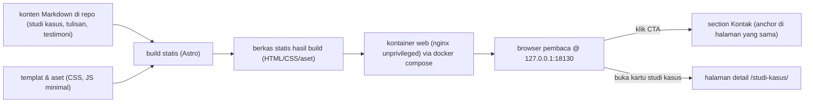

# Arsitektur portofolio-landing

## 1. Ringkasan
Situs statis Astro → `dist/` → nginx-unprivileged di Docker, hanya `127.0.0.1:18130`. Tanpa backend, DB, API, atau layanan eksternal. Status: kerangka (scaffold); section dan konten penuh dikerjakan sub-issue berikutnya.

## 2. Alur data


## 3. Komponen
Tanda ✓ = sudah ada di kerangka; lainnya direncanakan.

| Lokasi | Isi |
|---|---|
| `.docker/Dockerfile` ✓ | multi-stage: deps → build → runtime (nginx); target `test` (Playwright) |
| `.docker/config/nginx.conf` ✓ | port 8080, `try_files`, gzip, cache `/_astro/`, header keamanan |
| `.claude/rules/` ✓ | scope, localhost-only, content-fiktif, accessibility, performance-budget |
| `content/studi-kasus`, `content/tulisan`, `content/testimoni` ✓ (kosong) | Markdown per koleksi |
| `src/content.config.ts` ✓ | koleksi + skema zod (glob loader) |
| `src/layouts/BaseLayout.astro` ✓ | `<html lang="id">`, skip link (ThemeToggle + inline theme script menyusul) |
| `src/pages/index.astro` ✓ | placeholder dengan 9 penanda section |
| `src/data/site.ts` | persona, CTA, proof strip, keahlian, cara kerja (satu sumber) |
| `src/components/sections/` | Hero, ProofStrip, StudiKasus (+ CtaBlock), Keahlian, CaraKerja, Tulisan, Testimoni, Kontak, Footer |
| `src/pages/studi-kasus/[slug].astro` | 3 halaman detail |
| `src/scripts/` (`theme.ts`, `reveal.ts`), `src/styles/` (`tokens.css`, `global.css`) | JS klien minimal dan gaya |
| `tests/` | `e2e/*.spec.ts`, `content-check.mjs`, `lighthouse.mjs` |

## 4. Keputusan, alasan, alternatif ditolak
| Keputusan | Pilihan | Alasan | Sumber |
|---|---|---|---|
| Generator | Astro (`output: 'static'`), dikunci lockfile | HTML statis tanpa JS runtime default (AC5); content collections + zod memvalidasi Markdown (AC1, AC9); `getStaticPaths` untuk 3 detail | PRD A4/C3 |
| Build | `node:24-alpine` | base image resmi, LTS | docker-runtime |
| Penyaji | `nginxinc/nginx-unprivileged:1.28-alpine`, 8080, non-root | ringan, non-root | PRD A4 |
| JS klien | hanya `theme` (inline di `<head>`) dan `reveal` (IntersectionObserver) | AC4, AC10 dengan beban minimal | PRD R3 |
| Font | maks 2 keluarga, self-hosted woff2 (`@fontsource-variable/*`), subset latin, tanpa CDN | PRD C13, aset lokal | PRD C13/R3 |
| Routing | `build.format: 'file'`, `trailingSlash: 'never'` → `dist/studi-kasus/<slug>.html`; nginx `try_files $uri $uri.html $uri/ =404`, `absolute_redirect off` | `/studi-kasus/<slug>` langsung 200 tanpa redirect (AC3) | rancangan Architect WORK-20 |
| Port | host `127.0.0.1:18130` → container 8080 | `docker-runtime` (keputusan owner 2026-10-12) mewajibkan port host 1xxxx dan melarang 8080; PRD A7 membolehkan perubahan port | docker-runtime, PRD A7 |

Ditolak: HTML/CSS/JS murni + skrip build (pipeline Markdown dan routing buatan sendiri); Vite + vanilla (sama); Eleventy (tanpa validasi skema bawaan); React/Vue islands (menambah JS); Google Fonts/CDN (pihak ketiga, merugikan Performance).

## 5. Konten
- `studi-kasus`: `title`, `slug` (kebab-case ASCII), `order` (1-3), `ringkasan`, `peran`, `tahun`, `stack[]`, `metrik[{label,nilai}]`; isi Markdown = detail. Kartu dan halaman detail membaca frontmatter yang sama, sehingga metrik konsisten (BR1).
- `tulisan`: `title`, `tanggal`, `ringkasan` (daftar saja, tanpa halaman). `testimoni`: `nama`, `peran`, `organisasi` (fiktif), isi = kutipan.
- Section: `id` + `data-section`, urutan hero, bukti, studi-kasus, keahlian, cara-kerja, tulisan, testimoni, kontak, footer. Blok CTA berada di dalam section studi-kasus.

## 6. Tema, animasi, aksesibilitas (rencana)
- Tema: skrip inline membaca `localStorage['theme']` dengan fallback `prefers-color-scheme`, mengeset `data-theme`; toggle `<button aria-pressed>`. Token warna light/dark di `tokens.css` (maks 3 warna + 2 netral); tabel token dan rasio kontras ditambahkan saat token ditetapkan.
- Animasi: konten terlihat secara default; state tersembunyi hanya lewat kelas `.js`; `prefers-reduced-motion` mematikan transisi; hanya `opacity`/`transform`.
- Form kontak: input tanpa atribut `name`, hanya tampilan, pesan di region `aria-live`.

## 7. Runtime dan uji
```
docker compose -f compose.dev.yaml up -d --build
docker compose -f compose.dev.yaml --profile test run --rm test
docker compose -f compose.dev.yaml down
```
Strategi uji AC1-AC10: lihat `tests/README.md`.

## 8. Batas yang diketahui
Form hanya tampilan; tanpa halaman artikel; skor Lighthouse di VPS bersama bisa fluktuatif (median 3 run); tidak ada deploy; `compose.yaml` hanya memenuhi kontrak, bukan untuk deploy. Versi image Playwright wajib sama dengan `@playwright/test` di lockfile (belum terpasang).
