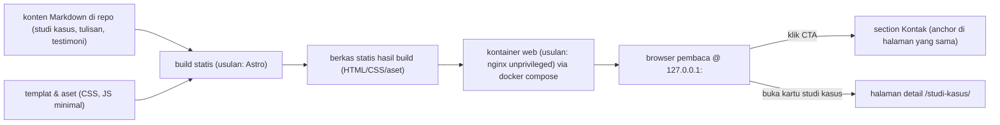

# PRD REQ-20261013-portofolio-landing v1 — Landing page portofolio software engineer fiktif (Dita Ayu Prameswari)

| Field | Nilai |
|---|---|
| REQ-ID | REQ-20261013-portofolio-landing |
| Versi | v1 |
| Plane key | PORTF-1 |
| Status | OWNER_REVIEW |
| Tanggal | 2026-10-13 19:04 WIB |
| Risk | LOW |
| Alasan risk | Hanya situs statis non-sensitif (konten fiktif, tanpa auth/DB/finance/deploy); dijalankan lokal di 127.0.0.1; tidak ada data perusahaan atau data pribadi nyata. Perubahan pada repo publik + project Multica baru tetap terkendali karena hanya branch, tanpa merge/deploy. |
| Versi sebelumnya | tidak ada |
| Ringkasan perubahan | tidak ada |

Catatan sumber (aturan c):
- Yang berkategori `owner` adalah kalimat-kalimat yang datang apa adanya dari brief owner (diteruskan HQ lewat task t_1105c7f8, disampaikan artrios atas instruksi raka 2026-10-13 19:01 WIB).
- Persona, 3 proyek fiktif, dan arah visual berasal dari konteks brainstorm HQ, jadi berkategori `usulan agent (belum disetujui owner)` — bukan instruksi owner dan bukan master plan.
- Catatan keterbatasan: rincian isi tiap section ("riwayat brainstorm HQ") TIDAK tersedia untuk engineering-management; hanya ringkasan yang ada di body task. Karena itu isi teks detail dirancang agent sebagai konten FIKSI dan harus direview owner pada versi PRD ini (lihat OQ).

---

# BAGIAN PRODUK

## 1. Overview

Masalah: belum ada artefak landing page portofolio yang bisa dipakai untuk mendemonstrasikan alur kedua Hermes → Multica pada proyek yang benar-benar baru (situs, konten, dan struktur baru), sementara brief membutuhkan satu halaman portofolio yang lengkap dan dapat diuji secara objektif.

Tujuan: menyediakan satu landing page statis portofolio untuk persona fiktif "Dita Ayu Prameswari" berisi 9 section pada satu halaman utama + 3 halaman detail studi kasus, dengan transisi animasi per section saat scroll, satu tujuan CTA yang diulang 3x, dan mode light/dark; dapat dibangun dan dijalankan lokal lewat `docker compose` di 127.0.0.1. Ini adalah demo alur (bukan untuk presentasi 14 Okt) dan tidak untuk dipublikasikan.

Ukuran sukses (terukur, minimal 1):
- UK1. Lighthouse (mode mobile) skor Performa ≥ 90 DAN Aksesibilitas ≥ 90 pada halaman utama dan ketiga halaman detail studi kasus. Cara ukur: Lighthouse lokal (headless), catat skor per halaman. Sumber data: output Lighthouse pada run uji.
- UK2. Ke-8 acceptance criteria milik owner (AC1–AC8, bagian 12) lulus dengan BUKTI perintah/output, bukan klaim. Cara ukur: jalankan cek di bagian 19. Sumber data: log uji.
- UK3. Rasio kontras teks ≥ 4.5:1 pada light DAN dark. Cara ukur: alat cek kontras (mis. axe/Lighthouse a11y atau hitung rasio), catat pasangan warna utama. Sumber data: hasil cek kontras.

## 2. Stakeholders, users, business context

- Owner: raka — pemilik keputusan, approver satu-satunya (Telegram 5625664463) atau artrios via Hermes CLI `--source artrios`.
- Pengguna akhir (pembaca situs): recruiter teknis, calon klien freelance, dan sesama engineer. Sumber: owner.
- Pelaksana: squad Multica (Project Manager + agent) di bawah project `portofolio-landing`; engineering-management TIDAK menulis kode.
- Konteks bisnis: situs ini artefak demo alur, kontennya FIKSI (persona dan 3 proyek fiktif), tanpa data perusahaan. Tujuan konversi tunggal: mengarahkan pembaca ke satu aksi kontak.

## 3. Requirements (persyaratan tingkat tinggi)

- REQ1. Aksesibilitas: situs dapat dibuka di browser modern ponsel dan desktop; tanpa login; seluruh tautan, tombol, dan form dapat dipakai dengan keyboard saja.
- REQ2. Pengguna: publik tanpa akun; tidak ada peran/autentikasi.
- REQ3. Cara input/perubahan data: konten ditulis sebagai berkas Markdown di dalam repo (studi kasus, tulisan, testimoni); tanpa CMS.
- REQ4. Kekhususan data: seluruh isi bersifat FIKSI (persona & proyek fiktif); DILARANG memakai data perusahaan atau data pribadi nyata. Metrik/klaim fiktif harus konsisten di seluruh halaman.
- REQ5. Notifikasi: tidak berlaku — tidak ada notifikasi/email; form kontak hanya tampilan dan tidak mengirim apa pun.
- REQ6. Kinerja/aksesibilitas: memenuhi AC1–AC8 (bagian 12), khususnya Lighthouse mobile Performa & Aksesibilitas ≥ 90 dan kontras ≥ 4.5:1 di light dan dark.
- REQ7. Tampilan: mode light/dark; transisi animasi per section saat scroll yang DINONAKTIFKAN bila `prefers-reduced-motion` aktif.
- REQ8. Operasional: dapat dibangun dan dijalankan lokal dengan `docker compose`, hanya pada `127.0.0.1`.

## 4. Core Features (MVP)

Fitur versi pertama (`tidak ada` fitur di luar daftar ini):

1. Satu halaman utama dengan TEPAT 9 section, urut: (1) Hero, (2) Proof strip, (3) Studi kasus, (4) Keahlian, (5) Cara kerja, (6) Tulisan, (7) Testimoni, (8) Kontak, (9) Footer.
2. Satu tujuan CTA yang SAMA, diulang 3x: di Hero, di akhir section Studi kasus (blok CTA, bukan section ke-10), dan di Footer.
3. 3 kartu studi kasus fiktif, masing-masing menautkan ke 1 halaman detail (total 3 halaman detail: `/studi-kasus/<slug>`, tiga slug dari 3 proyek fiktif). Setiap halaman detail punya jalan kembali ke halaman utama.
4. Transisi animasi per section saat scroll; dimatikan saat `prefers-reduced-motion: reduce`.
5. Mode light/dark (toggle), preferensi dihormati dan dapat diganti pengguna.
6. Konten dari Markdown di repo: 3 studi kasus, item "tulisan", item "testimoni" (isi disarankan sebagai berkas Markdown terpisah).
7. Form kontak TAMPILAN saja (tanpa backend/email).
8. Halaman berjalan lokal via `docker compose` (bind 127.0.0.1).

OPSIONAL (hanya bila owner memutuskan; di luar MVP default): halaman artikel terpisah untuk section "tulisan" (lihat OQ4).

## 5. User Flow

- UF1. Pembaca (ponsel): membuka halaman utama → membaca Hero + Proof strip → menelusuri 3 kartu studi kasus → membuka salah satu halaman detail → menekan "kembali"/logo ke halaman utama.
- UF2. Pembaca (desktop): sama dengan UF1 dengan tata letak lebar.
- UF3. Pembaca mengaktifkan mode dark (atau sistemnya sudah dark) → seluruh halaman memakai skema dark dengan kontras ≥ 4.5:1.
- UF4. Pembaca dengan `prefers-reduced-motion: reduce` → halaman tampil tanpa animasi transisi per section, konten tetap lengkap.
- UF5. Pembaca menekan CTA (di Hero / setelah Studi kasus / di Footer) → diarahkan ke section Kontak (satu tujuan yang sama).
- UF6. Pengguna keyboard: `Tab` menyusuri seluruh tautan/tombol/form dengan indikator fokus terlihat; form kontak tidak mengirim apa pun (hanya tampilan).
- UF7. (di luar aplikasi, konteks alur) squad membangun di branch fork, menjalankan `docker compose`, menguji AC, lalu lapor "siap review owner".

## 6. Architecture

Aliran data: berkas Markdown + templat → proses build statis → berkas statis yang disajikan kontainer web lokal di 127.0.0.1 → browser pembaca. Tidak ada server aplikasi, API, atau database.

Stack yang diusulkan (keputusan agent sesuai izin owner; lihat OQ2):
- Generator situs statis: Astro (output statis; JS minimal/opsional), koleksi konten dari Markdown.
- Penyajian lokal: `docker compose` dengan image web ringan (`nginxinc/nginx-unprivileged`), port dipublikasikan HANYA ke `127.0.0.1`.
- Alternatif bila owner memilih lain: HTML/CSS/JS statis murni + skrip build kecil; atau Vite + vanilla.

## 7. Database Schema

`tidak berlaku` — tidak ada basis data. Konten bersumber dari berkas Markdown di repo; tidak ada data yang disimpan, dikirim, atau di-query.

## 8. Design & Technical Constraints

Setiap butir mencantumkan SUMBER (aturan c). Kategori: `owner`, `master plan`, `usulan agent (belum disetujui owner)`.

- C1. Situs STATIS (tanpa backend/DB/server aplikasi).
  Sumber: owner — "situs statis".
- C2. Harus bisa dijalankan lokal dengan `docker compose`, HANYA di `127.0.0.1` (tidak pernah bind `0.0.0.0`).
  Sumber: owner — "bisa dijalankan lokal via docker compose di 127.0.0.1"; ditambah `org-operating-rules` §6 (never bind 0.0.0.0).
- C3. Stack dipilih agent (dalam batas statis + docker compose). Usulan: Astro + nginx unprivileged.
  Sumber: owner (delegasi "Stack: dipilih agent"); pilihan spesifik = usulan agent (belum disetujui owner) — OQ2.
- C4. Konten Markdown di dalam repo.
  Sumber: owner — "konten Markdown di repo".
- C5. Form kontak HANYA tampilan: tanpa backend, tanpa pengiriman email, tanpa penyimpanan.
  Sumber: owner — "form kontak hanya tampilan (tanpa backend/email)".
- C6. Tidak memakai data perusahaan (persona & proyek fiktif).
  Sumber: owner — "tidak memakai data perusahaan".
- C7. Transisi animasi per section saat scroll; DINONAKTIFKAN saat `prefers-reduced-motion` aktif.
  Sumber: owner — "transisi animasi per section saat scroll" + AC4 owner.
- C8. Mode light/dark.
  Sumber: owner — "mode light/dark".
- C9. Aksesibilitas: kontras teks ≥ 4.5:1 (light & dark); semua link/tombol/form bisa dipakai dengan keyboard saja; Lighthouse Aksesibilitas mobile ≥ 90.
  Sumber: owner — AC5, AC6, AC7.
- C10. Satu tujuan CTA diulang 3x (hero, setelah studi kasus, footer).
  Sumber: owner — brief fitur wajib.
- C11. Halaman utama = TEPAT 9 section dengan urutan sesuai brief; 3 halaman detail studi kasus.
  Sumber: owner — brief + AC2, AC3.
- C12. Tidak perlu "terminal mini" dan tidak perlu slider sebelum/sesudah.
  Sumber: owner — "Tidak perlu terminal mini atau slider sebelum/sesudah".
- C13. Arah visual editorial-teknis: maksimal 3 warna + 2 netral, maksimal 2 keluarga font, kontras ≥ 4.5:1, hormati `prefers-reduced-motion`.
  Sumber: usulan agent (belum disetujui owner) — konteks brainstorm HQ.
- C14. Target repo: fork `rakarangga/portofolio-landing` dari `devmhk/portofolio-landing` (branch `master` sumber). Batas keras: hanya branch; TANPA merge, TANPA deploy, TANPA kredensial produksi.
  Sumber: owner (target fork) + prosedur Multica (`multica-handoff` §1/§6, `org-operating-rules` §9).

## 9. Scope

Yang termasuk dalam PRD ini:
1. Landing page statis satu halaman dengan 9 section (urutan bagian 4) + 3 halaman detail studi kasus.
2. Transisi animasi per section saat scroll + penghormatan `prefers-reduced-motion`.
3. Satu tujuan CTA diulang 3x; mode light/dark.
4. Konten Markdown fiktif di repo (3 studi kasus minimal; item tulisan & testimoni).
5. Form kontak tampilan-saja.
6. Berkas `docker compose` untuk menjalankan lokal di `127.0.0.1`.
7. Acceptance criteria AC1–AC10 (bagian 12) + bukti pengujian.
8. Repo kerja: fork `rakarangga/portofolio-landing` (hanya setelah `PRD_APPROVED` dan approval langkah Multica).

## 10. Non-goals

Secara eksplisit TIDAK dikerjakan:
- Terminal mini; slider sebelum/sesudah (dinyatakan tidak perlu oleh owner).
- Backend/API, pengiriman email, penyimpanan data form (form kontak = tampilan saja).
- Data perusahaan nyata, data pribadi nyata, atau klaim faktual apa pun (semua isi fiktif).
- Halaman artikel terpisah untuk section "tulisan" (hanya bila owner memutuskan lain — OQ4).
- Hosting/publikasi/domain/TLS/deploy; situs hanya dijalankan lokal.
- CMS, analitik/tracker, komentar pengunjung.
- Multi-bahasa (bahasa tunggal mengikuti keputusan OQ1).
- Perubahan pada repo lain, infra, atau project Multica lain.

## 11. Business rules

- BR1. Semua konten fiktif dan harus konsisten satu sama lain (nama, peran, metrik proyek) di seluruh halaman.
- BR2. Dilarang menampilkan data perusahaan atau data pribadi nyata; tidak ada klaim yang bisa dibaca sebagai fakta nyata.
- BR3. Tidak ada data pengunjung yang dikumpulkan atau dikirim; form kontak tidak mengirim apa pun.
- BR4. Halaman tetap berfungsi (konten terbaca penuh) tanpa animasi, dan saat JavaScript minimal mati untuk bagian non-interaktif bila memungkinkan.
- BR5. Satu dan hanya satu tujuan CTA; ketiga kemunculan mengarah ke target yang sama.
- BR6. Halaman hanya diakses lewat `127.0.0.1`.

## 12. Acceptance criteria (testable, bernomor)

Delapan AC pertama diambil dari daftar owner (diterjemahkan menjadi dapat diuji, dengan bukti).

AC1. Build lulus tanpa error. Bukti: jalankan perintah build pada repo, exit code 0, tanpa error pada log.
AC2. Semua 9 section tampil di satu halaman, urutan sesuai brief (Hero, Proof strip, Studi kasus, Keahlian, Cara kerja, Tulisan, Testimoni, Kontak, Footer). Bukti: inspeksi DOM halaman utama — hitung & urutkan section (mis. ambil daftar `section`/id).
AC3. Ketiga halaman detail studi kasus dapat dibuka dari kartu dan kembali ke halaman utama. Bukti: 3 URL `/studi-kasus/<slug>` mengembalikan 200 dan memuat konten; dari ketiganya ada tautan kembali ke `/` yang berfungsi.
AC4. Transisi per section berjalan saat scroll; dimatikan saat `prefers-reduced-motion: reduce`. Bukti: uji 2 kondisi (motion normal vs reduced) dan catat perilaku elemen transisi.
AC5. Lighthouse mobile Performa ≥ 90 dan Aksesibilitas ≥ 90. Bukti: output Lighthouse (mode mobile) per halaman; catat nilai.
AC6. Kontras teks ≥ 4.5:1 di light dan dark. Bukti: hasil cek kontras untuk pasangan teks/latar utama di kedua mode.
AC7. Semua link, tombol, dan form bisa dipakai dengan keyboard saja. Bukti: navigasi `Tab`/`Shift+Tab` menelusuri seluruh elemen interaktif; fokus terlihat; tidak ada jebakan fokus.
AC8. Jalan lokal dengan `docker compose` di 127.0.0.1. Bukti: `docker compose up` dan halaman terbuka di `127.0.0.1:<port>`; port TIDAK terikat ke `0.0.0.0`.

AC turunan (bukti tambahan, di luar 8 AC owner):
AC9. Tidak ada data perusahaan/pribadi nyata; seluruh isi fiktif dan konsisten. Bukti: inspeksi teks + daftar konten fiktif.
AC10. Mode light/dark keduanya dapat diaktifkan dan preferensi dikenali. Bukti: toggle bekerja; menghormati `prefers-color-scheme` awal.

## 13. Assumptions

- A1. Bahasa konten: Bahasa Indonesia (`lang="id"`) — menunggu konfirmasi owner (OQ1).
- A2. Isi teks detail (proof strip, keahlian, cara kerja, tulisan, testimoni, CTA) dikarang agent sebagai FIKSI konsisten dengan persona & 3 proyek dari brainstorm; owner mereview di PRD ini (OQ5).
- A3. Section "tulisan" = daftar judul + ringkasan di halaman utama; TANPA halaman artikel terpisah (OQ4).
- A4. Stack: Astro (build statis) + `nginx unprivileged` untuk penyajian lokal (OQ2).
- A5. Konten Markdown ditempatkan di folder `content/` per koleksi (mis. `content/studi-kasus/*.md`) (OQ3).
- A6. Pada stage implementasi, PM menjalankan skill `repo-access` (langkah pertama) dan (project baru) scaffold; fork `rakarangga/portofolio-landing` dibuat/disiapkan pada tahap itu, bukan oleh PRD ini.
- A7. Port lokal: `8080` dipublikasikan di `127.0.0.1` (dapat diubah bila bentrok — OQ7).
- A8. Pengujian cukup lokal; tidak ada tuntutan deploy.

## 14. Open questions

TIDAK ada butir [BLOCKING]: PRD dapat dinilai dan dibangun dengan asumsi tercatat (A1–A8). Semua butir di bawah [NON-BLOCKING] dan diikuti asumsi terkait; owner dapat mengoreksi pada putaran review/approval versi ini.

- OQ1 [NON-BLOCKING] Bahasa konten: Indonesia atau Inggris (atau keduanya)? Asumsi A1: Indonesia (`lang="id"`). Dampak bila salah: seluruh teks isi harus ditulis ulang.
- OQ2 [NON-BLOCKING] Pemilihan stack. Usulan A4: Astro + nginx unprivileged (dalam batas statis + docker compose). Owner boleh menetapkan lain.
- OQ3 [NON-BLOCKING] Penempatan konten Markdown. Usulan A5: folder `content/` per koleksi.
- OQ4 [NON-BLOCKING] Cakupan section "tulisan": cukup daftar judul + ringkasan (asumsi A3), atau perlu halaman artikel terpisah per tulisan? Bila perlu halaman terpisah, itu PENAMBAHAN SCOPE → PRD baru (v2) dan kembali ke OWNER_REVIEW.
- OQ5 [NON-BLOCKING] Teks fiktif (proof strip, keahlian, cara kerja, tulisan, testimoni, teks CTA) dikarang agent (A2). Owner dapat meminta penggantian teks sebelum approve; perubahan material atas scope → versi baru.
- OQ6 [NON-BLOCKING] Target CTA: anchor ke section Kontak (usulan) vs `mailto:` fiktif. Usulan: anchor ke section Kontak (tanpa pengiriman apa pun).
- OQ7 [NON-BLOCKING] Port lokal `docker compose`: usulan 8080 di 127.0.0.1 (A7).
- OQ8 [NON-BLOCKING] Sumber arah visual (C13) tetap `usulan agent` (brainstorm HQ) sampai owner menyatakan lain.

Catatan: rincian isi section dari "riwayat brainstorm HQ" tidak tersedia untuk engineering-management; OQ5 menutup celah ini (agent mengarang fiksi, owner mereview).

## 15. Dependencies

- D1. Approval owner untuk PRD v1 (gate 1) — belum ada; PRD ini belum disetujui.
- D2. Approval owner untuk LANGKAH MULTICA (gate 2) — belum ada. `handoff.md` hanya ditulis setelah `PRD_APPROVED`.
- D3. Fork `rakarangga/portofolio-landing` dari `devmhk/portofolio-landing` siap + akses squad (dibuat/disiapkan via skill `repo-access`; BUKAN oleh PRD ini).
- D4. Project Multica `portofolio-landing` + squad Project Manager tersedia (project baru; issue induk baru).
- D5. Konten fiktif disetujui owner (OQ5) sebelum atau bersamaan dengan approval PRD.

## 16. Risks & level risiko

Level risiko keseluruhan: LOW (situs statis non-sensitif; tanpa auth/DB/finance/deploy; hanya lokal + branch).

- R1 (LOW): isi fiktif tidak sesuai harapan owner (persona/tone/teks). Mitigasi: OQ5, review owner pada putaran ini.
- R2 (LOW): bahasa konten salah pilih → rework teks. Mitigasi: OQ1; tanyakan sebelum/bersamaan approval.
- R3 (LOW): Lighthouse mobile gagal ≥ 90 (biasanya karena bobot animasi/font/aset). Mitigasi: JS/CSS minimal, 2 keluarga font, aset lokal, uji Lighthouse sebelum review.
- R4 (LOW): animasi mengganggu aksesibilitas. Mitigasi: AC4 (`prefers-reduced-motion`) + AC7 keyboard.
- R5 (LOW): scope melebar (mis. halaman artikel tambahan "tulisan", terminal mini). Mitigasi: Non-goals bagian 10 mengikat; penambahan scope → PRD baru + return ke OWNER_REVIEW.
- R6 (LOW): port lokal terikat ke `0.0.0.0`. Mitigasi: C2 + AC8 (bind `127.0.0.1`).
- R7 (LOW): fork/akses repo belum siap menghambat handoff. Mitigasi: D3, langkah pertama PM `repo-access`; bukan penghalang PRD.

## 17. Data & security considerations (tanpa secret)

- Tidak ada data pengguna dikumpulkan, disimpan, atau dikirim; tidak ada cookie/analitik/tracker.
- Tidak ada rahasia (token/kredensial) di halaman, repo, atau log.
- Form kontak hanya tampilan: tidak ada endpoint, tidak ada email keluar.
- Kontainer/port hanya di `127.0.0.1`; tidak bind `0.0.0.0` (`org-operating-rules` §6).
- Konten 100% fiktif: tidak boleh memuat data perusahaan/pribadi nyata (BR2, AC9).

## 18. Target repo & permissions yang dibutuhkan

- Repo sumber: `devmhk/portofolio-landing` (public, branch `master`, isi baru README).
- Fork target kerja squad: `rakarangga/portofolio-landing`.
- Project Multica: `portofolio-landing` (project baru; issue induk BARU).
- Plane key: PORTF-1.
- Izin yang diminta (setelah `PRD_APPROVED` + approval langkah Multica): buat/ubah berkas di dalam fork pada BRANCH saja.
- BATAS KERAS: tanpa merge, tanpa deploy, tanpa kredensial produksi, tanpa menyentuh repo/infra/project lain. PRD ini sendiri tidak membuat branch/repo/project/issue Multica.

## 19. Definition of done & isi handoff

Definition of done (tahap implementasi, SETELAH kedua approval):
- AC1–AC8 lulus dengan bukti perintah/output (bukan klaim); AC9–AC10 sebagai bukti tambahan.
- Halaman utama memuat tepat 9 section urut brief; 3 halaman detail studi kasus dapat dibuka & kembali ke halaman utama.
- `docker compose` menjalankan situs lokal di `127.0.0.1`; build lulus tanpa error.
- Lighthouse mobile Performa & Aksesibilitas ≥ 90; kontras ≥ 4.5:1 di light & dark; keyboard-only bersih.
- Tidak ada data perusahaan/pribadi; isi fiktif konsisten; tanpa terminal mini/slider.
- Diserahkan sebagai laporan "siap review owner" dengan bukti uji; tanpa merge/deploy.

Yang masuk paket handoff (`handoff.md`, hanya setelah `PRD_APPROVED`):
1. REQ-ID + tautan ke PRD v(N) yang disetujui.
2. Versi PRD, approver, timestamp.
3. Target repo/fork + izin (branch saja).
4. Scope, non-goals, AC, risiko, dependencies.
5. Cek/tes yang harus dijalankan + kriteria selesai.
6. Batas: branch saja, tanpa merge/deploy/kredensial produksi.
7. Apa yang harus dikembalikan + siapa reviewer berikutnya (owner).

---

## Perubahan vs versi sebelumnya

tidak ada (ini PRD v1).
